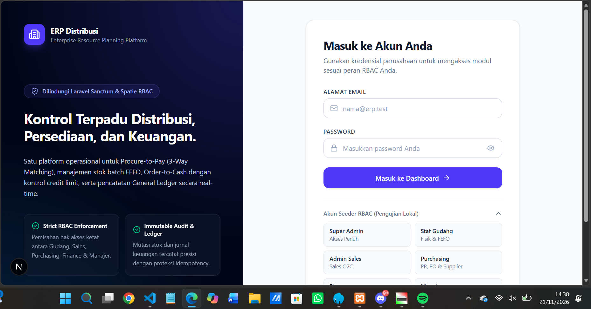
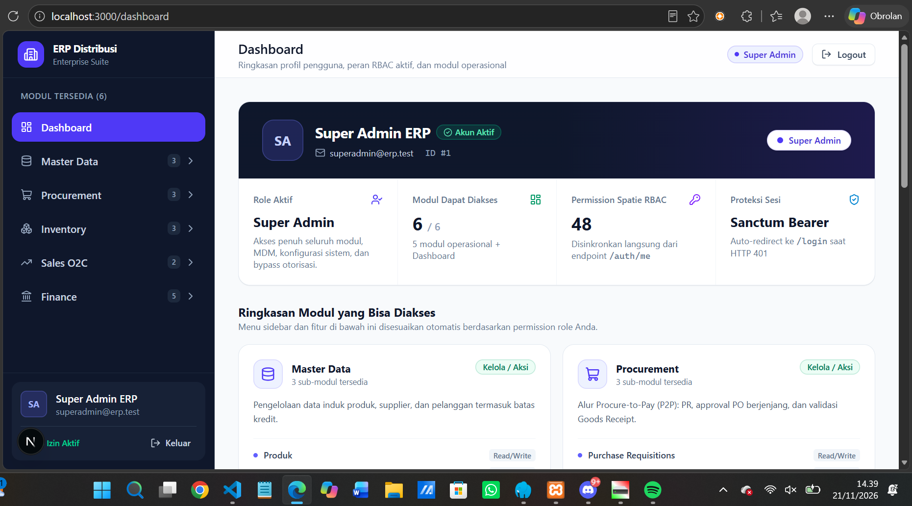
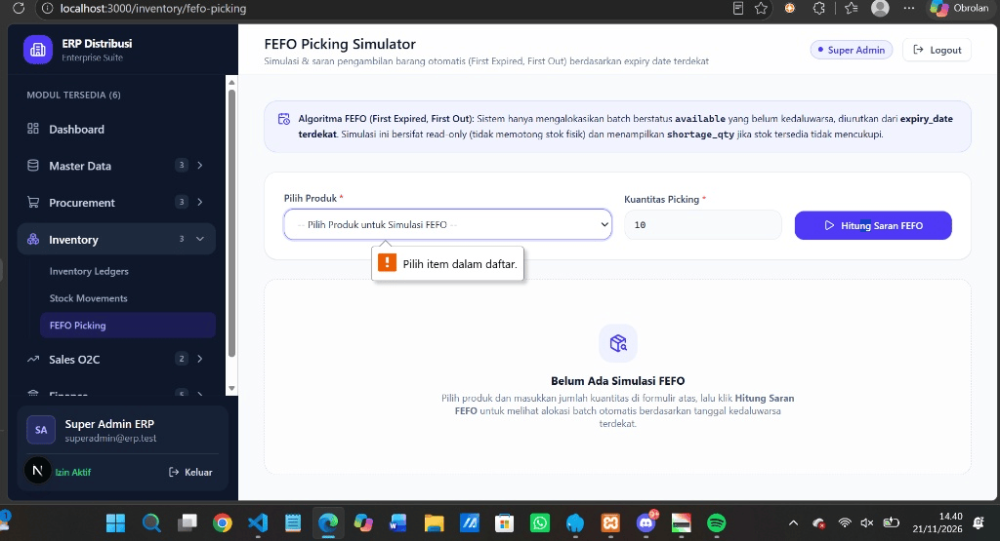
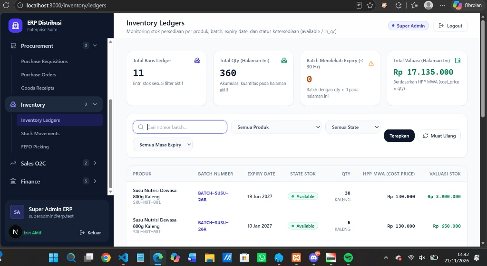

# ERP Distribusi — Enterprise Resource Planning System

Sistem **Enterprise Resource Planning (ERP) Distribusi** modern berbasis full-stack untuk mengelola operasional end-to-end perusahaan distribusi: mulai dari **Master Data**, **Procure-to-Pay (P2P)**, **Inventory & Warehouse Management**, **Order-to-Cash (O2C)**, hingga **Finance & General Ledger** secara terintegrasi, presisi, dan aman dengan kontrol akses berbasis peran (**Strict RBAC**).

---

## Ringkasan Proyek & Tech Stack

Repositori ini menggunakan arsitektur terpisah antara backend REST API dan frontend web modern:

### Backend (`erp_backend`)
- **Framework:** Laravel 11 (PHP `^8.2`)
- **Database:** MySQL (`InnoDB`, transactional ACID)
- **Autentikasi:** Laravel Sanctum (API Bearer Token)
- **Otorisasi:** Spatie Laravel Permission (`spatie/laravel-permission`) — Strict Role-Based Access Control (6 peran, 44+ permission granular)
- **Presisi Keuangan:** Ekstensi PHP **BCMath** + tipe kolom `DECIMAL(15,2)`
- **Testing:** PHPUnit (45 Feature Tests, 950 Assertions)

### Frontend (`erp_frontend`)
- **Framework:** Next.js App Router (Next.js 16, React 19)
- **Bahasa:** TypeScript (`^5`)
- **Styling & UI:** Tailwind CSS (`v4`) + Lucide Icons
- **HTTP Client:** Axios dengan interceptor autentikasi Sanctum & penanganan error terstruktur

---

## Sorotan Arsitektur & Engineering

Dirancang untuk standar sistem enterprise dengan fokus tinggi pada integritas data, konsistensi konkurensi, dan kepatuhan akuntansi:

- **Presisi Finansial `DECIMAL(15,2)` + BCMath**
  Seluruh perhitungan nominal uang, pajak, subtotal, HPP (COGS), saldo akun, dan batas kredit menggunakan tipe `DECIMAL(15,2)` di level database serta fungsi aritmetika presisi tinggi `bcadd`, `bcsub`, `bcmul`, dan `bcdiv` (BCMath) di lapisan service untuk menghilangkan *floating-point rounding drift*.
- **Immutable Stock & General Ledger**
  Buku besar persediaan (`stock_movements`) dan buku besar akuntansi (`journal_entries` & `journal_items`) bersifat *append-only* (tidak dapat diubah atau dihapus secara destruktif). Setiap mutasi operasional menghasilkan jejak audit permanen dan jurnal *double-entry* yang selalu seimbang (Debit = Kredit).
- **Idempotency Key (`HTTP 409 Conflict`)**
  Endpoint transaksi kritis (penerimaan barang, pengiriman, penagihan, dan pembayaran) dilindungi oleh validasi *Idempotency Key*. Pengiriman ulang request yang sama akan ditolak secara aman dengan respons `HTTP 409 Conflict` guna mencegah pemotongan stok ganda atau duplikasi jurnal.
- **Pessimistic Locking (`lockForUpdate()`)**
  Seluruh operasi mutasi stok, alokasi batch, perhitungan MWA, dan pengecekan *credit limit* dijalankan dalam `DB::transaction()` menggunakan `lockForUpdate()` pada baris terkait untuk mencegah *race condition* dan *overselling* di lingkungan multi-user.
- **3-Way Matching (Procure-to-Pay)**
  Verifikasi otomatis tiga dokumen — **Purchase Order (PO)**, **Goods Receipt (GR)**, dan **Vendor Invoice/Bill** — memastikan pembayaran utang usaha (AP) hanya diproses sesuai kuantitas yang benar-benar diterima di gudang dan harga yang disepakati.
- **Moving Weighted Average (MWA) COGS**
  Harga Pokok Penjualan (HPP) dihitung ulang secara dinamis setiap kali barang masuk melalui Goods Receipt berdasarkan nilai persediaan eksisting dan biaya pembelian terbaru, lalu dicatat akurat ke jurnal COGS saat barang keluar.
- **FEFO Picking (*First-Expired, First-Out*)**
  Mesin alokasi gudang secara otomatis memilih stok dari batch dengan tanggal kedaluwarsa (*expiry date*) paling dekat terlebih dahulu saat memproses Delivery Order, meminimalkan risiko barang kedaluwarsa (*expired loss*).
- **Automated Quality Assurance — 45 Feature Tests / 950 Assertions**
  Cakupan pengujian integrasi menyeluruh (`tests/Feature/`) yang memverifikasi kontrak API, isolasi hak akses RBAC, skenario *edge case* stok, FEFO, MWA, 3-Way Matching, *credit limit override*, hingga keseimbangan General Ledger.

---

## Screenshots

> Letakkan tangkapan layar aplikasi pada direktori [`docs/screenshots/`](docs/screenshots/) dengan nama file berikut agar tampil otomatis di dokumentasi ini.

### 1. Halaman Login & RBAC Portal


### 2. Dashboard Eksekutif & Operasional


### 3. Gudang & FEFO Batch Picking


### 4. Finance & Immutable General Ledger


---

## Struktur Direktori

```text
erp_system/
├── docs/
│   └── screenshots/          # Dokumentasi visual / tangkapan layar aplikasi
├── erp_backend/              # REST API Laravel 11 (Auth, P2P, Inventory, O2C, Finance)
└── erp_frontend/             # Web Application Next.js App Router + TypeScript
```

---

## Panduan Instalasi Lokal

### Prasyarat
- **PHP** `>= 8.2` (dengan ekstensi `bcmath`, `pdo_mysql`, `mbstring`, `openssl`)
- **Composer** `>= 2.x`
- **MySQL** `>= 8.0`
- **Node.js** `>= 20.x` & **npm**

---

### 1. Setup Backend (`erp_backend`)

```bash
cd erp_backend

# 1. Install dependensi PHP
composer install

# 2. Salin file environment dan generate application key
cp .env.example .env
php artisan key:generate
```

Buka file `erp_backend/.env` dan sesuaikan konfigurasi database MySQL Anda:

```env
DB_CONNECTION=mysql
DB_HOST=127.0.0.1
DB_PORT=3306
DB_DATABASE=erp_system
DB_USERNAME=root
DB_PASSWORD=
```

Pastikan database `erp_system` sudah dibuat di MySQL, lalu jalankan migrasi, seeder, dan server API:

```bash
# 3. Jalankan migrasi & seeder (termasuk 6 akun demo RBAC & data awal)
php artisan migrate --seed

# 4. Jalankan server Laravel API (default: http://127.0.0.1:8000)
php artisan serve
```

Untuk menjalankan seluruh test suite (45 Feature Tests / 950 Assertions):

```bash
php artisan test
```

---

### 2. Setup Frontend (`erp_frontend`)

Buka terminal baru, lalu jalankan langkah berikut:

```bash
cd erp_frontend

# 1. Install dependensi Node.js
npm install
```

Buat file `erp_frontend/.env.local` dan arahkan ke URL API backend Laravel:

```env
NEXT_PUBLIC_API_URL=http://127.0.0.1:8000/api
```

Jalankan server pengembangan atau build produksi:

```bash
# Mode pengembangan (default: http://localhost:3000)
npm run dev

# Atau verifikasi build produksi
npm run build
npm run start
```

---

## Akun Demo RBAC

Setelah menjalankan `php artisan migrate --seed`, tersedia **6 akun demo** dengan password default `password` untuk menguji pemisahan hak akses (*Strict RBAC*) di seluruh modul:

| Peran (Role) | Email | Password | Cakupan Hak Akses Utama |
| :--- | :--- | :--- | :--- |
| **Super Admin** | `superadmin@erp.test` | `password` | Akses penuh ke seluruh modul, manajemen user/role, pengaturan sistem, dan audit log. |
| **Staf Gudang** | `gudang@erp.test` | `password` | Operasional fisik barang (Goods Receipt, Delivery Order, FEFO Picking, Stock Opname). Dilarang mengakses HPP, harga jual, dan jurnal keuangan. |
| **Admin Sales** | `sales@erp.test` | `password` | Siklus Order-to-Cash (Sales Order, melihat stok tersedia, harga jual, dan credit limit pelanggan). Tidak dapat mengubah stok fisik atau HPP. |
| **Purchasing** | `purchasing@erp.test` | `password` | Kelola Master Produk & Supplier, Purchase Requisition, Purchase Order, pembaruan harga beli, serta approval PO hingga Rp 10.000.000. |
| **Finance** | `finance@erp.test` | `password` | Invoicing, 3-Way Matching, AP/AR, Pembayaran, Rekonsiliasi Bank, General Ledger, dan Laporan Keuangan. |
| **Manajer** | `manajer@erp.test` | `password` | Executive Dashboard, Audit Log, Approval PO di atas batas limit Purchasing, serta Override Credit Limit pelanggan. |

---

## Lisensi

Proyek ini dikembangkan untuk kebutuhan portofolio dan referensi arsitektur sistem ERP Distribusi.
